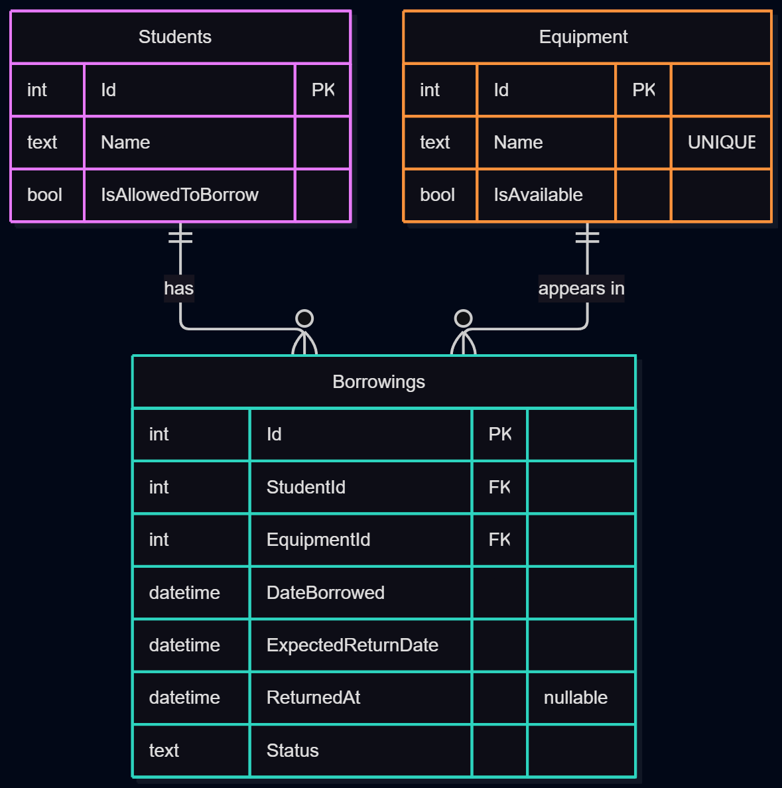

# Equipment Borrowing System

This repository contains our ITSD 81 laboratory work on a campus equipment borrowing system. The desktop application uses C#/.NET, Avalonia with MVVM, EF Core, and PostgreSQL.

**Lab 4 is the current version.** The notes for Labs 1 to 3 are included below to document how the project developed. Some code and setup instructions in those earlier sections refer to previous versions and no longer apply to the current application.

---

## Laboratory Activity 4: PostgreSQL, Checkout, Histories and Search

The equipment custodian can use the following screens:

| Screen | Use cases |
|---|---|
| Equipment Catalog | UC-01 view catalog, UC-02 available equipment, UC-03 borrow one item |
| Multi-Item Checkout | UC-06 borrow several items in one transaction |
| Active Borrowings | UC-04 view active borrowings, UC-05 return equipment |
| Search Borrowings | UC-09 search, filter and sort records; return a selected borrowing |
| Students | UC-12 register, UC-13 edit, UC-14 permit/restrict, UC-07 student history |
| Manage Equipment | UC-15 register, UC-16 edit, UC-08 equipment history |

The Lab 4 documents are in [`docs/lab4/`](docs/lab4/):

- [Use case diagram and catalog](docs/lab4/use-case-catalog.md)
- [14-case use case suite](docs/lab4/use-case-suite.md)
- [Traceability matrix](docs/lab4/traceability-matrix.md)
- [Verification evidence A01 to A19](docs/lab4/verification-evidence.md), with [screenshots](docs/lab4/evidence/screenshots/) and [database and test output](docs/lab4/evidence/terminal-output/)

### 1. Prerequisites

- Windows, macOS or Linux
- [.NET 10 SDK](https://dotnet.microsoft.com/download)
- [PostgreSQL](https://www.postgresql.org/download/) 16 or newer (tested with PostgreSQL 18.6 on Windows), including the `psql` command-line tool
- Git
- EF Core command-line tool:

      dotnet tool install --global dotnet-ef

### 2. Installation

Clone the repository, then restore and build the solution:

    git clone https://github.com/Beeejooorn/EquipmentBorrowing_DAD-ACT-1.git
    cd EquipmentBorrowing_DAD-ACT-1/EquipmentBorrowing
    dotnet restore
    dotnet build

Run the remaining commands from the `EquipmentBorrowing` directory, which contains `EquipmentBorrowing.slnx`.

### 3. Configure PostgreSQL

The application gets its connection string from .NET user secrets or an environment variable. No database password is stored in the repository. For local setup, run:

    dotnet user-secrets set "ConnectionStrings:EquipmentBorrowing" "Host=localhost;Port=5432;Database=equipmentborrowing;Username=postgres;Password=YOUR_PASSWORD" --project src/EquipmentBorrowing.Infrastructure

Replace `YOUR_PASSWORD` with the password configured for your local PostgreSQL user.

You can also set `ConnectionStrings__EquipmentBorrowing` as an environment variable. It takes precedence over user secrets; see `DatabaseSettings.cs`. When no connection string is configured, the application displays an error message instead of showing credentials.

### 4. Apply database migrations

    dotnet ef database update --project src/EquipmentBorrowing.Infrastructure

This creates `equipmentborrowing` if necessary and applies the `20261111045753_InitialPostgreSqlSchema` migration. To list the migrations:

    dotnet ef migrations list --project src/EquipmentBorrowing.Infrastructure

The app also calls `Database.Migrate()` at startup. Lab 4 uses PostgreSQL, so the SQLite migrations from Lab 3 were removed. Moving old SQLite rows into PostgreSQL is not required for this activity.

### 5. Initial data

`DatabaseInitializer` inserts sample records only when both the Students and Equipment tables are empty. Existing records are not replaced.

- **Students:** Ana Reyes and Ben Cruz have borrowing history; Carla Santos is restricted; Dan Lim has no borrowing history.
- **Equipment:** Laptop 01 and Camera 01 start as borrowed. Laptop 02, Projector 01, Tablet 01 and Microphone 01 start as available; Microphone 01 has never been borrowed.
- **Borrowings:** 2 active and 3 returned records.

### 6. Run the application

    dotnet run --project src/EquipmentBorrowing.Desktop

Alternatively, choose `EquipmentBorrowing.Desktop` as the startup project in Visual Studio and press F5.

### 7. Run the automated tests (optional)

    dotnet test

The tests use `equipmentborrowing_test` on the configured PostgreSQL server. The test database is reset before each test, so the main `equipmentborrowing` database is not used. Test coverage includes borrowing rules, validation, rollback, unknown commit outcomes, database constraints and connection errors. The saved Lab 4 test log reports 66 passing tests.

To run the direct PostgreSQL constraint checks, follow the instructions in [`docs/lab4/sql/constraint-demo.sql`](docs/lab4/sql/constraint-demo.sql). Use a disposable database.

### 8. Architecture

```text
Avalonia View (XAML)            Views/*.axaml          bindings and commands only
      │
ViewModel                        ViewModels/*.cs        screen state, loading/empty/error state
      │
Application Service              Application/Services   business rules BR-01 to BR-19
      │
Repository abstraction           IUnitOfWork, IStudentRepository, IEquipmentRepository, IBorrowingRepository
      │
EF Core infrastructure           EfUnitOfWork, Ef*Repository, EquipmentBorrowingDbContext, migrations
      │
PostgreSQL (Npgsql)              keys, foreign keys, unique and check constraints
```

- **Domain:** `Student`, `Equipment` and `Borrowing` contain the data and state-changing methods, such as `UpdateDetails`, `SetEligibility` and `MarkAsReturned`. They do not contain database code.
- **Application:** Services implement the borrowing and management rules through repository and unit-of-work interfaces. `OperationResult` and `QueryResult<T>` carry the outcome and message back to the UI.
- **Infrastructure:** EF Core and Npgsql handle persistence, entity configurations, migrations and repositories. This project also contains `DatabaseErrorClassifier` and `DatabaseInitializer`.
- **Desktop:** Avalonia Views and ViewModels handle input and display. Dependencies are registered in `App.axaml.cs`; Views and ViewModels do not access `DbContext` or SQL directly.

#### DbContext lifetime and dependency injection

`AddDbContextFactory<EquipmentBorrowingDbContext>` registers a factory rather than one shared context. `IUnitOfWorkFactory` creates a new `EfUnitOfWork` and `DbContext` for each operation, and the service disposes them with `await using`.

A desktop window can stay open for a long time. Keeping one `DbContext` for that whole period could return stale tracked data and cause problems when asynchronous operations overlap. Using a new context for each operation avoids sharing that state.

Services and ViewModels are registered as transient. `MainViewModel` retains the screen ViewModels during the app session. `CheckoutFailureSimulator` is a singleton so the checkout screen and service use the same demonstration settings.

Database requests use asynchronous EF Core methods such as `ToListAsync`, `SaveChangesAsync` and `CommitAsync`. Lists and histories distinguish loading, empty, missing-record and connection-error states. History loading also ignores outdated results when the selected student changes (`_historyRequestNumber`).

#### Transactions

Each write operation uses one `DbContext` and a PostgreSQL transaction with `Serializable` isolation (`EfUnitOfWork.BeginTransactionAsync`). The service rechecks the student, eligibility, active borrowing count and equipment availability inside the transaction, then commits the changes together.

For **UC-06**, a multi-item checkout saves all borrowing records and availability changes in the same transaction. If a known failure happens before commit, none of those changes are kept. Single-item borrowing (UC-03) and multi-item checkout use the same `IssueAsync` implementation.

PostgreSQL constraints provide another layer of protection. The schema enforces unique student numbers and equipment codes after normalization, valid foreign keys and dates, and at most one active borrowing for each item. Serializable transactions help handle conflicting requests made at the same time.

A connection failure during commit can make the outcome unknown (BR-18). In that case, the app reports that it cannot confirm whether the transaction was committed and tells the user to refresh and check the records. It does not retry automatically.

The Multi-Item Checkout screen also has two test options for the lab demonstration. One simulates failure after the first write but before commit, and the other simulates a lost commit acknowledgement. Both are off by default and should only be used with disposable data.

#### Database design (PostgreSQL)

| Table | Main columns | Constraints |
|---|---|---|
| Students | Id, StudentNumber (30), Name (100), ContactInfo (100, optional), IsAllowedToBorrow, StudentNumberKey (generated: `upper(btrim(StudentNumber))`) | PK; unique `IX_Students_StudentNumberKey`; checks for nonblank required fields and optional contact |
| Equipment | Id, EquipmentCode (30), Name (100), Description (200, optional), IsAvailable, EquipmentCodeKey (generated) | PK; unique `IX_Equipment_EquipmentCodeKey`; nonblank checks |
| Borrowings | Id, StudentId, EquipmentId, DateBorrowed, ExpectedReturnDate, Status (Active/Returned), ReturnedAt (optional) | PK; FKs with `ON DELETE RESTRICT`; partial unique index `IX_Borrowings_OneActivePerEquipment` where `Status = 'Active'`; date and status checks |

Dates use PostgreSQL `date` columns and C# `DateOnly`. Records are not hard-deleted, so borrowing history stays available.

### 9. Git history

The repository retains the commits from earlier labs. For Lab 4, the work was committed in stages: remove unused console code, switch from SQLite to PostgreSQL, add student and equipment management, implement multi-item checkout, add histories and search, then add tests and verification documentation. Use `git log --oneline` to review the commit history.

---

## Earlier Activities (Labs 1 to 3)

The following sections describe the project at the time of each earlier activity. They are kept for reference. The current application uses the Lab 4 architecture and PostgreSQL instructions above.

### Activity 1: Layered Solution Structure

Lab 1 started with a small C#/.NET solution for equipment borrowing, split into Domain, Application and Infrastructure projects.

#### 1. Solution Structure

- **Domain:** Defines `Student`, `Equipment`, `Borrowing` and `BorrowingStatus`, including methods such as `MarkAsUnAvailable()` and `MarkAsReturned()`. It does not handle storage or display.
- **Application:** Defines repository interfaces (`IStudentRepository`, `IEquipmentRepository`, `IBorrowingRepository`) and `BorrowEquipmentService`. The service applies the borrowing rules through those interfaces.
- **Infrastructure:** Uses `InMemoryStudentRepository`, `InMemoryEquipmentRepository` and `InMemoryBorrowingRepository` to store records in `List<T>` collections.
- **Tests:** Reserved for application and domain tests at this stage.
- **ConsoleDemo:** Wired the projects together and demonstrated one accepted and one rejected borrowing request.

#### 2. Dependency Direction

```text
      ConsoleDemo
          │
          ▼
     Application
       │      ▲
       ▼      │
     Domain   │
              │
     Infrastructure
```

- **ConsoleDemo** used Application services and Infrastructure repositories.
- **Application** depended on Domain and on repository interfaces, not Infrastructure implementations.
- **Infrastructure** depended on Domain and Application to implement those interfaces.
- **Domain** did not depend on the other projects.

#### 3. Use Case Mapping

```text
Actor: Student
Use Case: Borrow Equipment
Application Service: BorrowEquipmentService.BorrowAsync
Domain Objects Used: Student, Equipment, Borrowing, BorrowingStatus
Repository Interfaces Used: IStudentRepository, IEquipmentRepository, IBorrowingRepository
Infrastructure Implementations Used: InMemoryStudentRepository, InMemoryEquipmentRepository, InMemoryBorrowingRepository
```

#### 4. Reflection

**1. Why should the application service depend on a repository interface instead of directly depending on a database implementation?**

`BorrowEquipmentService` only needs to know what repository operations are available. It does not need to know whether the data is stored in memory or in a database. This separation also makes it easier to test the service using a different repository implementation.

**2. Which parts of your current solution could remain unchanged if SQLite were added later?**

Domain classes and Application services could stay the same because they do not depend on a specific database. Infrastructure would need new repository implementations using EF Core and SQLite.

**3. Which project would eventually contain Avalonia Views?**

A separate UI project, such as `EquipmentBorrowing.UI`, would contain the Avalonia Views. It would call the Application services and register Infrastructure dependencies at startup.

**4. Should an Avalonia button directly execute database queries? Why or why not?**

No. A button should call an Application service such as `BorrowEquipmentService.BorrowAsync`. Putting queries directly in button handlers would couple the UI to the database and could bypass shared borrowing rules.

**5. What part of your implementation represents the actual business operation requested by the actor?**

`BorrowEquipmentService.BorrowAsync` handles the borrowing operation. It checks that the student exists and can borrow, that the item exists and is available, and that the borrowing limit has not been reached before creating a record.

#### Demonstration (Lab 1 version)

At the time of Lab 1, running `EquipmentBorrowing.ConsoleDemo` demonstrated:

- **Success:** Student 1 borrows Equipment 1 when borrowing is allowed and the item is available.
- **Rejection:** Student 2 is not allowed to borrow Equipment 1, so the request is rejected.

The console demo was removed during Lab 4. Domain models and repository interfaces were part of earlier local work and were committed during service implementation.

### Activity 2: Avalonia UI and MVVM

#### 1. Desktop Project

Lab 2 added `EquipmentBorrowing.Desktop` as the presentation layer. The Views display data and collect input, while ViewModels call Application services. Infrastructure was registered through `App.axaml.cs`. Domain and Application did not depend on Avalonia.

#### 2. Updated Architecture

```text
Avalonia View
     │
     │ Binding / Command
     ▼
ViewModel
     │
     │ Application Operation
     ▼
Application Service
     │
     ├──────────► Domain
     │
     ▼
Repository Interface
     ▲
     │
Infrastructure Implementation
```

#### 3. Borrow Equipment Flow

1. The user selects a student, an item and an expected return date, then clicks **Borrow Equipment**.
2. `EquipmentViewModel.BorrowCommand` checks whether the required fields are selected.
3. The ViewModel calls `BorrowEquipmentService.BorrowAsync(studentId, equipmentId, expectedReturnDate)`.
4. The service checks the borrowing rules through the repositories and returns a result.
5. The ViewModel displays `StatusMessage` and reloads the equipment list.

#### 4. Return Equipment Flow

1. The user selects an active borrowing and clicks **Return Equipment**.
2. `BorrowingsViewModel.ReturnCommand` checks that a record is selected.
3. In the Lab 2 version, it called `ReturnEquipmentService.ReturnAsync(borrowing)` with the selected record.
4. The service checked whether the borrowing could be returned, updated its status and made the equipment available.
5. The ViewModel displayed the result and refreshed the list.

#### 5. Architectural Reflection

**1. Why should the View not call a repository directly?**

The View should not depend on a particular storage implementation. Calling Application services keeps database access and business rules separate from the UI.

**2. Why should business rules not be implemented in the ViewModel?**

Other screens may need the same rules. Keeping those checks in Application services avoids duplication and inconsistent behavior.

**3. What is the responsibility of the ViewModel?**

It manages presentation state such as `SelectedEquipment` and `StatusMessage` and exposes commands such as `BorrowCommand`. It passes the request to an Application service for validation and processing.

**4. Why can the existing Application layer work without knowing that Avalonia is being used?**

It uses Domain objects and repository interfaces rather than Avalonia classes. The same services can be called from another type of UI.

**5. What advantage is gained from registering dependencies in one composition point?**

`App.axaml.cs` contains the registrations for the services and repository implementations. This keeps the setup in one place instead of spreading it across the Views and ViewModels.

**6. If the in-memory repository were replaced by SQLite later, which parts of the current interface should remain largely unchanged?**

The Views, ViewModels and Application services could remain mostly the same. Infrastructure repositories and the startup registrations would need to change.

---

## Laboratory Activity 3: From In-Memory Data to Persistent Storage

### 1. Relational Database Design



| Table | Columns | Keys / Constraints |
|---|---|---|
| Students | Id, Name (max 100), IsAllowedToBorrow | PK: Id |
| Equipment | Id, Name (max 100), IsAvailable | PK: Id; UNIQUE index on Name |
| Borrowings | Id, StudentId, EquipmentId, DateBorrowed, ExpectedReturnDate, ReturnedAt (nullable), Status (text, max 20) | PK: Id; FK: StudentId to Students.Id; FK: EquipmentId to Equipment.Id; indexes on StudentId, EquipmentId, Status |

A student can have many borrowings, and one item can appear in many borrowings over time. Borrowings store student and equipment IDs instead of repeating their details. `ReturnedAt` is empty until the item is returned. Sample SQL is in `docs/database-queries.sql`.

### 2. SQLite and EF Core

Lab 3 added `Microsoft.EntityFrameworkCore.Sqlite` and `Microsoft.EntityFrameworkCore.Design` to Infrastructure and installed `dotnet-ef`. Database code stayed in Infrastructure; the Desktop project registered services in `App.axaml.cs`.

### 3. DbContext

`EquipmentBorrowingDbContext` exposes `DbSet` properties for Students, Equipment and Borrowings. The entity configurations (`StudentConfiguration`, `EquipmentConfiguration`, `BorrowingConfiguration`) define keys, required fields, maximum lengths, foreign keys and how the borrowing status is stored. The Domain classes have no persistence code.

### 4. Repository Transition

Before:

    Repository Interface -> In-Memory Repository

After:

    Repository Interface -> EF Core Repository -> DbContext -> SQLite

`EfStudentRepository`, `EfEquipmentRepository` and `EfBorrowingRepository` replaced the in-memory versions behind the same interfaces. `UpdateAsync` was added to `IBorrowingRepository`, and `GetAvailableAsync` was added to `IEquipmentRepository`. The database file was stored at `%LocalAppData%\EquipmentBorrowing\equipmentborrowing.db`.

### 5. Migration Process

These are the commands used for the Lab 3 SQLite version, not the current PostgreSQL setup.

Create the migration:

    dotnet ef migrations add InitialCreate --project src\EquipmentBorrowing.Infrastructure --output-dir Migrations

Add the seed-data migration:

    dotnet ef migrations add AddSeedData --project src\EquipmentBorrowing.Infrastructure --output-dir Migrations

Apply the migrations:

    dotnet ef database update --project src\EquipmentBorrowing.Infrastructure

The app also called `Database.Migrate()` on startup. It created the database on first run and kept existing data on later runs.

Lab 3 seed data included Ana Reyes, Ben Cruz and Carla Santos (restricted), plus Laptop 01, Laptop 02, Projector 01 and Camera 01.

### 6. Generated SQL

**Query 1: Active borrowings**

    _context.Borrowings.AsNoTracking()
        .Where(b => b.Status == BorrowingStatus.Active)
        .ToListAsync();

Generated SQL:

    SELECT "b"."Id", "b"."DateBorrowed", "b"."EquipmentId", "b"."ExpectedReturnDate",
           "b"."ReturnedAt", "b"."Status", "b"."StudentId"
    FROM "Borrowings" AS "b"
    WHERE "b"."Status" = 'Active'

EF Core translates the LINQ status filter into a SQL `WHERE` clause.

**Query 2: All equipment**

    _context.Equipment.AsNoTracking().ToListAsync();

Generated SQL:

    SELECT "e"."Id", "e"."IsAvailable", "e"."Name"
    FROM "Equipment" AS "e"

This query retrieves all equipment rows without tracking them for changes.

**Query 3: Available equipment**

`GetAvailableAsync` filters on `IsAvailable` and orders the results by `Name`.

**Tracking:** Read-only queries use `AsNoTracking()` to avoid tracking entities that will not be updated. The service loads tracked equipment records when it needs to change their availability.

### 7. Persistence Demonstration

1. Borrowed Laptop 02 as Ana Reyes and confirmed the record appeared under Active Borrowings.
2. Closed and restarted the app. The borrowing was still listed.
3. Returned the item and restarted again. Active Borrowings was empty and Laptop 02 was marked available.

Screenshots for the Lab 3 version are in `screenshots/`.

### 8. Architectural Reflection

1. **Why was no rewrite needed?** The services depended on repository interfaces, so the database change mainly affected Infrastructure and startup registration.
2. **Why should the ViewModel not use DbContext directly?** That would mix the UI with persistence logic, bypass service rules and make the ViewModel harder to test.
3. **What does the repository implementation do now?** It translates application requests into EF Core queries and writes data to SQLite.
4. **Purpose of a migration:** It records schema changes in code so the database structure can be recreated.
5. **Why are foreign keys important?** They prevent a borrowing record from referencing a student or item that does not exist.
6. **Why does a read-only query benefit from AsNoTracking()?** EF Core skips tracking records that will not be modified.
7. **If SQLite were replaced by another provider:** The provider, connection configuration and migrations would change in Infrastructure, while Domain, Application and UI code could mostly stay the same.
