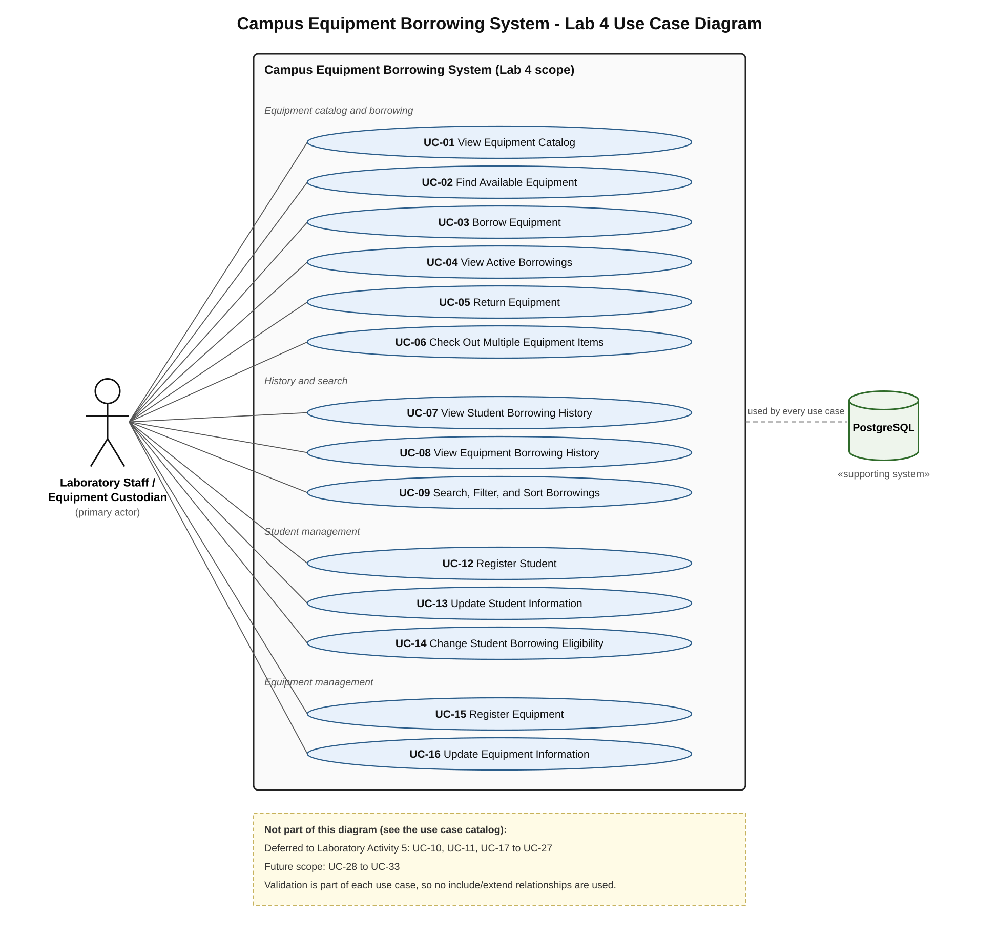

# Lab 4 – Use Case Diagram and Catalog

**Primary actor:** Laboratory Staff / Equipment Custodian (called "staff" below).
**Supporting system:** PostgreSQL (every use case reads or writes it).

Students do not use the application themselves. The staff member works the screens for them.

## Use case diagram

Source of the picture: [`use-case-diagram.svg`](use-case-diagram.svg).

The diagram only shows the fourteen use cases that are in scope for Lab 4. Validation (required fields, the borrowing limit, availability and so on) is part of each use case's own steps. It is not drawn as separate `<<include>>` or `<<extend>>` use cases, as the lab instructions ask.

## Catalog

| ID | Use case | Lab 4 classification | Screen in the app |
|---|---|---|---|
| UC-01 | View Equipment Catalog | Required continuation | Equipment Catalog |
| UC-02 | Find Available Equipment | Required continuation | Equipment Catalog → "Show available equipment only" |
| UC-03 | Borrow Equipment | Required continuation | Equipment Catalog → Borrow Equipment box |
| UC-04 | View Active Borrowings | Required continuation | Active Borrowings |
| UC-05 | Return Equipment | Required continuation | Active Borrowings (also Search Borrowings) |
| UC-06 | Check Out Multiple Equipment Items | Required new | Multi-Item Checkout |
| UC-07 | View Student Borrowing History | Required new | Students → history panel |
| UC-08 | View Equipment Borrowing History | Required new | Manage Equipment → history panel |
| UC-09 | Search, Filter, and Sort Borrowings | Required new | Search Borrowings |
| UC-10 | View Overdue Borrowings | Deferred to Laboratory Activity 5 | – |
| UC-11 | View Current Equipment Holder | Deferred to Laboratory Activity 5 | – |
| UC-12 | Register Student | Required new | Students → Register New Student |
| UC-13 | Update Student Information | Required new | Students → Save Changes to Selected |
| UC-14 | Change Student Borrowing Eligibility | Required new | Students → Permit / Restrict Borrowing |
| UC-15 | Register Equipment | Required new | Manage Equipment → Register New Equipment |
| UC-16 | Update Equipment Information | Required new | Manage Equipment → Save Changes to Selected |
| UC-17 | Retire Equipment from Circulation | Deferred to Laboratory Activity 5 | – |
| UC-18 | Mark Equipment as Under Maintenance | Deferred to Laboratory Activity 5 | – |
| UC-19 | Restore Equipment to Circulation | Deferred to Laboratory Activity 5 | – |
| UC-20 | Record Equipment Condition Upon Return | Deferred to Laboratory Activity 5 | – |
| UC-21 | Renew or Extend an Active Borrowing | Deferred to Laboratory Activity 5 | – |
| UC-22 | Return Multiple Equipment Items | Deferred to Laboratory Activity 5 | – |
| UC-23 | View Borrowings Due Soon | Deferred to Laboratory Activity 5 | – |
| UC-24 | View Student's Active Borrowing Count | Deferred to Laboratory Activity 5 | – |
| UC-25 | View Equipment Utilization Summary | Deferred to Laboratory Activity 5 | – |
| UC-26 | Manage Equipment Categories | Deferred to Laboratory Activity 5 | – |
| UC-27 | Void an Erroneous Borrowing Without Erasing Its History | Deferred to Laboratory Activity 5 | – |
| UC-28 | Request an Equipment Reservation | Future scope | – |
| UC-29 | Approve, Reject, or Cancel Reservations | Future scope | – |
| UC-30 | Review Staff Action Audit History | Future scope | – |
| UC-31 | Manage Staff Accounts and Permissions | Future scope | – |
| UC-32 | Export Borrowing Reports | Future scope | – |
| UC-33 | Integrate External Services or Notifications | Future scope | – |

**Summary:** 5 required continuations, 9 required new, 13 deferred to Lab 5, 6 future scope.

Notes:
- The Multi-Item Checkout screen also shows "Lab Four Tester is eligible and has 2 of 3 active borrowings" for the selected student. This is only a helper message inside UC-06. It is not UC-24, which stays deferred.
- No hard delete exists in the app. Students, equipment and borrowings are never deleted, so history is always kept (BR-14).

The full tables for the fourteen required cases are in [`use-case-suite.md`](use-case-suite.md).
